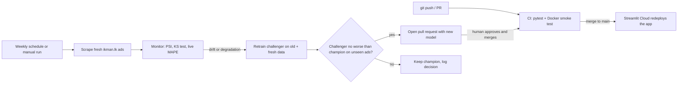

# MLOps pipeline — Sri Lankan used-car price model

An automated loop that tests every change, watches the live model for drift, retrains when needed, and redeploys only models that pass a quality gate. It follows the pipeline demonstrated in Lecture 10 (CI → CD → monitoring → drift → retrain → approval → redeploy), using GitHub Actions and Streamlit Community Cloud so it costs nothing.



## Components
| Stage | What | File |
|---|---|---|
| Continuous integration | Unit tests for cleaning, the shipped model, a release **quality gate** (R² ≥ 0.85, MAPE ≤ 20 %) and the Streamlit app; then a Docker build and a container health check | `.github/workflows/ci.yml`, `tests/` |
| Continuous deployment | Every merge to `main` redeploys the Streamlit Cloud app. The same image can run anywhere (`Dockerfile`) | `Dockerfile`, Streamlit Cloud |
| Monitoring | Weekly: collects fresh ads the model has never seen; per-feature **PSI** and **KS test** against the training data; **live accuracy** (MAPE) of the deployed model; checks the live app responds | `mlops/monitor.py`, `.github/workflows/monitor-retrain.yml` |
| Drift trigger | PSI > 0.20 on any feature, or live MAPE > 1.3 × the test MAPE | `mlops/monitor.py` |
| Retraining | Same pipeline, tuned hyper-parameters from the notebook, trained on old + 60 % of fresh ads | `mlops/train.py` |
| Champion / challenger | Both models are scored on the other 40 % of fresh ads (unseen by either). Promoted only if the challenger's log-RMSE is not meaningfully worse (within a 2 % tolerance, because the holdout is only ~40–60 ads and differences below that are noise) | `mlops/train.py` |
| Human approval | The workflow opens a **pull request**; a person reviews the report and merges (as in the lecture demo, where an approval request gates the release) | workflow |
| Versioning | `model_meta.json` records version, date, git SHA and training rows; datasets and models are versioned in git; every retrain decision is appended to `monitoring/retrain_history.jsonl` | `monitoring/` |

## Azure deployment (Container Apps)
The Docker image is built by GitHub Actions, published to GitHub Container Registry (`ghcr.io/crazy-diya/car-price-app`) and run on **Azure Container Apps** (Malaysia West, Azure for Students): 0.5 vCPU, 1 GiB, scale-to-zero, at most 1 replica, so idle cost is about zero.

* Live Azure app: https://car-price-app.bluemeadow-a6e43a1f.malaysiawest.azurecontainerapps.io
* Resources: resource group `rg-car-price-mlops`, environment `cae-car-price`, app `car-price-app`.
* `deploy-azure.yml` rolls out each new image automatically **if** the repository secret `AZURE_CREDENTIALS` (a service principal limited to the resource group) is set. Without it, deploy manually:
  `az containerapp update -n car-price-app -g rg-car-price-mlops --image ghcr.io/crazy-diya/car-price-app:<git-sha>`
* The first request after idle takes about 30–60 s while the container starts (scale from zero).

## Run it
```bash
pip install -r requirements.txt -r requirements-mlops.txt
pytest tests                                       # CI tests
python scrape_ikman_cars.py --max-ads 150 --max-pages 80 --exclude-csv ikman_cars.csv \
       --cache data/fresh_raw.jsonl --out-csv data/fresh_batch.csv
python mlops/monitor.py --fresh data/fresh_batch.csv
python mlops/train.py --fresh data/fresh_batch.csv
```
GitHub: **Actions → Monitor and retrain → Run workflow** (tick *force_retrain* to demonstrate the whole loop).

## Honest limitations
* The app's ± error range uses `test_metrics`, evaluated on 597 cars. A retrain only replaces it if it is evaluated on at least 300 ads; smaller checks (e.g. 40 fresh ads) are stored as `latest_eval` instead, because a small sample gives an overly optimistic error.
* Streamlit Community Cloud has no persistent storage, so predictions made in the app are **not logged**. Fresh ikman.lk ads stand in for production traffic when checking drift and live accuracy. With Azure/Container Apps the app could log requests to a storage account.
* Fresh ads are asking prices, like the training data, so drift in *asking* prices is what is measured.
* Retraining reuses the notebook's tuned hyper-parameters rather than re-running the full search; re-tune manually if the data changes a lot.
